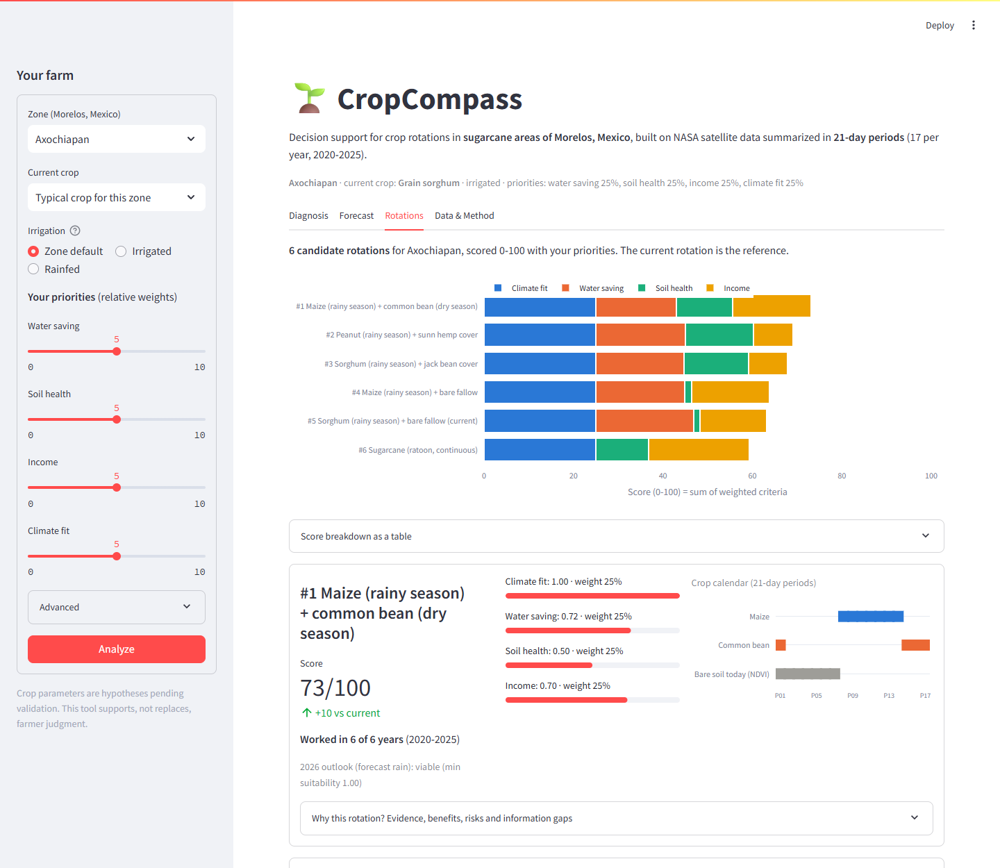
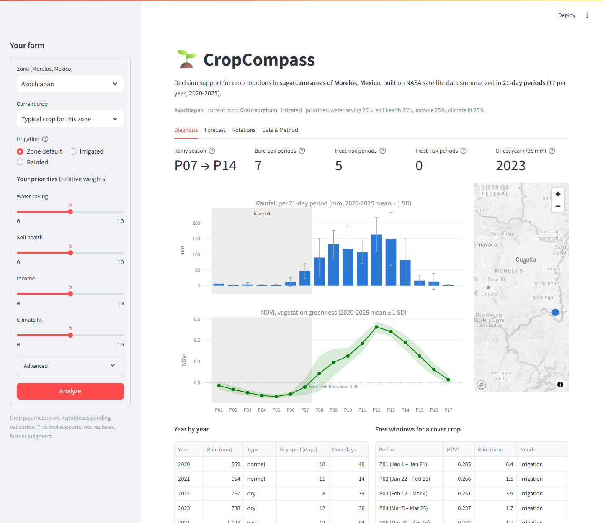
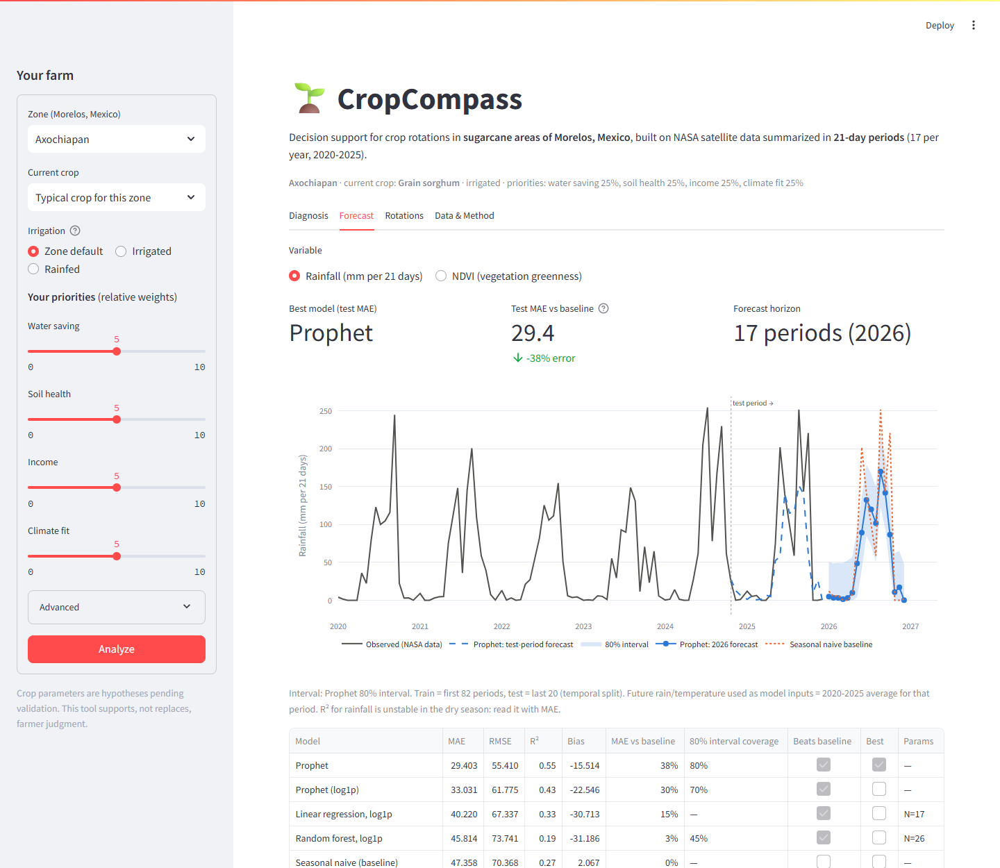
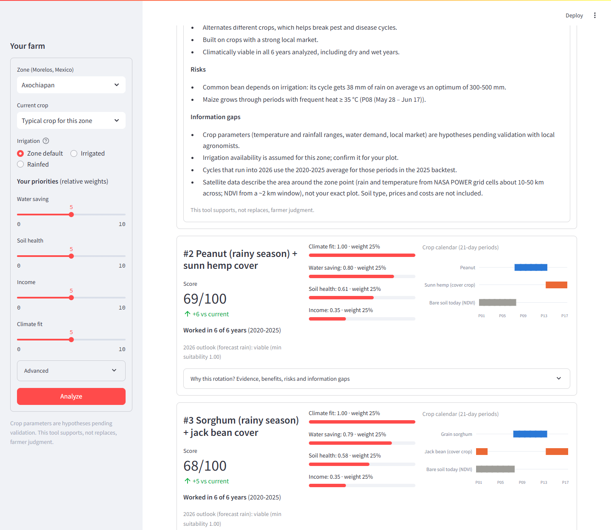

# CropCompass

**NASA Space Apps Challenge 2026 · *Field Shift: Adapting Farms with NASA Data***

A decision-support prototype for farmers in the sugarcane areas of **Morelos, Mexico**. It turns six years of NASA
satellite data into a zone diagnosis, a one-year forecast, and a transparent comparison of crop rotations, and it
explains *why* each option is suggested, with what evidence, what risks, and what still needs validation.

> This tool supports, not replaces, farmer judgment. Crop parameters are hypotheses pending validation with local agronomists.



## What it does

A farmer (or extension agent) picks a **zone**, their **current crop**, whether the plot is **irrigated**, and how much
they care about **water saving, soil health, income and climate fit**. The app then:

1. **Diagnoses the zone** (2020-2025): rainy season, bare-soil periods seen from space, heat and frost risk, dry spells,
   and dry / normal / wet years.
2. **Forecasts** rainfall and vegetation (NDVI) for the next 17 periods (one year), and shows how each model did
   against a simple baseline on held-out data.
3. **Compares 6-7 rotations, including the current one**, with a 0-100 score broken down by criterion and a
   backtest: *"worked in X of 6 years"*, listing the years that failed, which crop failed, why, and whether the year was dry or wet.
4. **Explains each rotation** in plain language: why it is suggested, the numbers behind it, benefits, risks, and information gaps.

| Diagnosis | Forecast |
|---|---|
|  |  |



## How it works

### The unit of analysis: 21-day periods

Every year is split into **17 fixed periods anchored to January 1**. Period *k* starts on day `1 + 21·(k−1)`; the last
period (P17) absorbs the remaining 29-30 days. Each period has a readable label, e.g. `P08 (May 28 – Jun 17)`.

Why 21 days: monthly data are too coarse for sowing windows and dry spells, and daily data are too noisy. Because the
periods are fixed, **P08 of 2021 is directly comparable with P08 of 2024**, so seasonality is exactly 17 periods.
Crop calendars given in months are converted with `periods = round(months × 30.44 / 21)`, and a sowing month maps
to the period that contains its first day.

### Pipeline

```
NASA POWER daily (IMERG rain, temperature) ─┐
MODIS MOD13Q1 NDVI (16-day composites) ─────┼─► 21-day integrated table (3 zones × 6 years × 17 periods = 306 rows)
                                            │      │
                                            │      ├─► Diagnosis (climatology, bare soil, rainy season, risks, year types)
                                            │      ├─► Forecast (baseline vs Prophet vs sliding-window ML, temporal split)
                                            │      └─► Crop suitability (EcoCrop-style) ─► Rotation score + backtest ─► Explanations
```

- **Integration.** Daily rain and temperature are summed or averaged per period. NDVI composites (every 16 days,
  which do not align with 21-day periods) are cleaned of cloudy pixels, **linearly interpolated to daily values**
  (never across gaps longer than 32 days, never extrapolated) and averaged per period. `ndvi_obs` records how many
  real composites fell in each period, so interpolation is always visible.
- **Diagnosis.** Bare soil = mean NDVI < 0.30 (adjustable in the app). Rainy season = first to last period with
  more than 35 mm per 21 days on average. Heat risk = at least 3 days ≥ 35 °C per period on average. Frost = Tmin ≤ 2 °C.
  Years are classed dry / normal / wet by terciles of annual rain.
- **Crop suitability (0-1).** EcoCrop-style trapezoids for mean temperature over the crop's periods and total
  rainfall over its cycle, plus a frost penalty for frost-sensitive crops. **The weakest factor is the suitability**
  and is reported as the limiting factor. With irrigation, rainfall does not limit.
- **Rotation score (0-100)** = weighted sum of four criteria, using the user's weights:
  - *Climate fit*: average suitability of the rotation's crops.
  - *Water saving*: 1 − water demand, weighted by how many periods each crop occupies (adding a dry-season crop counts as more water).
  - *Soil health*: nitrogen fixation, year-round cover, crop diversity, and the share of the zone's bare-soil periods the rotation covers.
  - *Income*: local market strength of the crops.
- **Backtest.** Suitability is recomputed with the real weather of each year 2020-2025. A year *worked* if **every
  crop** in the rotation reached suitability ≥ 0.6.
- **Explanations** are deterministic English templates filled with the computed numbers. No language model runs in the app.

### Forecast evaluation

- **Temporal split**: the last 20 % of periods (20 of 102) are held out, never a random or stratified split.
- Every model forecasts the whole held-out block **from the end of training**, exactly like the real forecast. Future
  rain or temperature used as model inputs are replaced by the training-period average, so there is no information leak.
- **Models**: seasonal naive baseline (same period last year), Prophet (yearly seasonality, flat trend; for NDVI
  with rain from the two previous periods as regressors), and sliding-window Linear Regression and Random Forest
  (window N ∈ {9, 17, 26} chosen by `TimeSeriesSplit`, recursive multi-step). Rainfall also gets `log1p` variants.
- **Metrics**: MAE (main), RMSE, R², bias, and 80 % interval coverage. R² for rainfall is unstable in the dry season, so it is never used alone.
- The best model per zone and variable is refit on all data to forecast 2026. If its own 80 % band covered fewer than
  70 % of test values, a symmetric band from its test errors is shown instead.

**Results on the held-out periods (late 2024 – 2025):**

| Zone | Variable | Best model | Test MAE | Baseline MAE | Error reduction | 80% band coverage |
|---|---|---|---|---|---|---|
| Axochiapan | Rainfall (mm / 21 d) | Prophet | 29.4 | 47.4 | 38% | 80% |
| Cuautla | Rainfall (mm / 21 d) | Prophet | 22.1 | 32.3 | 32% | 85% |
| Zacatepec | Rainfall (mm / 21 d) | Prophet (log1p) | 25.4 | 34.8 | 27% | 75% |
| Axochiapan | NDVI | Random forest | 0.036 | 0.046 | 23% | 55% |
| Cuautla | NDVI | Prophet + rain lags | 0.023 | 0.028 | 16% | 70% |
| Zacatepec | NDVI | Prophet + rain lags | 0.018 | 0.027 | 33% | 80% |

The best model beats the baseline in all six cases. The full comparison of every model is in the app's *Forecast*
tab and in `data/processed/metricas.csv`. Two decisions came from checking these results: Prophet uses a **flat trend**
(with a linear trend it extrapolated the wet 2024-2025 years to 1,070-1,190 mm/year against a ~950 mm average), and
an interval is replaced when it proved too narrow (random-forest tree spreads often covered only 40-60 % of test values).
Prophet's interval sampling uses a fixed seed, so results are reproducible run to run.

## NASA data used

| Data | Product | Access | Use |
|---|---|---|---|
| Rainfall | **GPM IMERG** (`IMERG_PRECTOT`), daily; `PRECTOTCORR` as fallback | [NASA POWER API](https://power.larc.nasa.gov/) | Rain per period, rainy season, dry spells, year types, forecast |
| Temperature | **NASA POWER** daily Tmax / Tmin (MERRA-2) | NASA POWER API | Crop suitability, heat and frost risk |
| Vegetation | **MODIS MOD13Q1 v061** NDVI, 16-day, 250 m, with pixel reliability | [ORNL DAAC MODIS web service](https://modis.ornl.gov/data/modis_webservice.html) | Bare soil, cover-crop windows, NDVI forecast |

Coverage: 2020-01-01 to 2025-12-31, three zones (Zacatepec, Cuautla, Axochiapan). NDVI is the median of the usable
pixels in a 9 × 9 pixel window (~2 × 2 km) around each zone point. Only 4 of 420 composites were flagged cloudy.
The raw downloads are kept unedited in `data/raw/`.

## How to run

Requires **Python 3.11**.

```bash
python -m venv .venv
# Windows: .venv\Scripts\activate   ·   macOS/Linux: source .venv/bin/activate
pip install -r requirements.txt

streamlit run app/streamlit_app.py      # open http://localhost:8501
```

On Windows, clone into a short path (e.g. `C:\dev\fieldshift`): Prophet bundles CmdStan with very long file paths,
and `pip install` fails if the project folder is deeply nested and long paths are not enabled.

The processed data and forecasts are committed, so the app starts without retraining. To rebuild everything from `data/raw/`:

```bash
python -m core.periodos      # clean data + 21-day table (data/clean, data/processed/serie_21d.csv)
python -m core.indicadores   # zone diagnosis (data/processed/diagnostico.json)
python -m core.pronostico    # model comparison + 2026 forecast (~20 s)
python -m core.rotaciones    # rotation ranking in the console
pytest                       # 83 tests, including headless runs of the app for every zone
```

**Deploying on Streamlit Community Cloud:** push the repository to GitHub, create an app with main file
`app/streamlit_app.py`, and choose Python 3.11 under *Advanced settings*. Static hosts and serverless platforms such
as Vercel do not fit: Streamlit needs a long-running server with a websocket, and Prophet's bundled CmdStan exceeds
typical serverless function size limits.

### Project structure

```
core/           pure Python logic (no Streamlit): datos, periodos, indicadores, pronostico, aptitud, rotaciones, explicacion
app/            Streamlit interface
data/raw/       original downloads (unedited)        data/clean/      validated daily data
data/config/    zones, crop parameters (hypotheses), rotations
data/processed/ 21-day table, diagnosis, metrics, forecasts
tests/          pytest suite             docs/            screenshots
```

## Limitations

- **Crop parameters are hypotheses.** Temperature and rainfall ranges, water demand, soil cover and local market
  values are approximate ranges inspired by FAO EcoCrop and general agronomy. They were not verified one by one and
  must be validated with local agronomists. They can be edited in the app's *Data & Method* tab.
- **Three zones, one point each.** Satellite data describe the area around each zone point (rain and temperature
  from NASA POWER grid cells about 10-50 km across; NDVI from a ~2 km window), not a specific plot. Soil type, prices,
  costs and labor are not included.
- **Irrigation is assumed** for all three zones (team input, pending confirmation; Axochiapan's typical crop is
  rainfed sorghum). With irrigation, almost every rotation is climatically viable, so the ranking is driven by water,
  soil and income. The *Rainfed* option shows where rainfall would limit.
- **Cuautla temperatures are likely ~4 °C too cold**: its MERRA-2 grid cell averages 2,120 m of elevation while the
  farmed valley is about 1,300 m. The app shows this warning.
- **Six years is short.** The climatology, the dry / normal / wet classes and the backtest rest on 2020-2025 only. The
  forecast test window is a single block that fell in wet years, so the metrics compare models well but do not make the 2026 forecast precise.
- **IMERG vs POWER rainfall.** Dry spells are shorter with IMERG than with POWER's bias-corrected `PRECTOTCORR`
  (e.g. 22 vs 26-28 days in Zacatepec in 2023).
- **Heat** enters the suitability only through mean temperature. Days ≥ 35 °C are reported as a risk, not scored.
- **Bare soil from NDVI.** A ~2 km window mixes land covers. Zacatepec never drops below NDVI 0.30 because sugarcane
  is perennial, so the bare-soil part of the soil criterion does not apply there.
- The draft cover-crop sowing months (October) only partly overlap the bare-soil windows (January-May). Local practice should guide them.

## AI tools used

- **Claude Code** (Anthropic; models Claude Opus 5.5 and Claude Fable 5.2) wrote the code, tests, data-download script and this README,
  working phase by phase from a plan and a project brief (`CLAUDE.md`) written by the team. The team made the product
  and design decisions (zones, irrigation, which phases to run or skip, adding crop diversity to the soil criterion)
  and approved each phase.
- **AI-drafted content**: the crop parameters in `data/config/cultivos.json` and the candidate rotations in
  `data/config/rotaciones.json` were drafted by the AI from general knowledge of EcoCrop-style ranges and local
  crops. They are labeled as hypotheses everywhere.
- **No AI runs inside the app.** Scores, forecasts and explanations are deterministic and reproducible. Explanations
  are fixed templates filled with computed numbers.

## References

- NASA POWER Project, NASA Langley Research Center. https://power.larc.nasa.gov/
- Huffman, G. J. et al. *GPM Integrated Multi-satellitE Retrievals for GPM (IMERG)*. NASA GES DISC. https://gpm.nasa.gov/data/imerg
- Didan, K. (2021). *MODIS/Terra Vegetation Indices 16-Day L3 Global 250m SIN Grid V061* (MOD13Q1). NASA EOSDIS LP DAAC. https://doi.org/10.5067/MODIS/MOD13Q1.061
- ORNL DAAC (2018). *MODIS and VIIRS Land Products Global Subsetting and Visualization Tool*. https://doi.org/10.3334/ORNLDAAC/1379
- FAO. *EcoCrop* crop environmental requirements. https://gaez.fao.org/pages/ecocrop
- Taylor, S. J. & Letham, B. (2018). Forecasting at scale. *The American Statistician*, 72(1), 37-45. https://doi.org/10.1080/00031305.2017.1380080
- Pedregosa, F. et al. (2011). Scikit-learn: Machine Learning in Python. *JMLR*, 12, 2825-2830.
